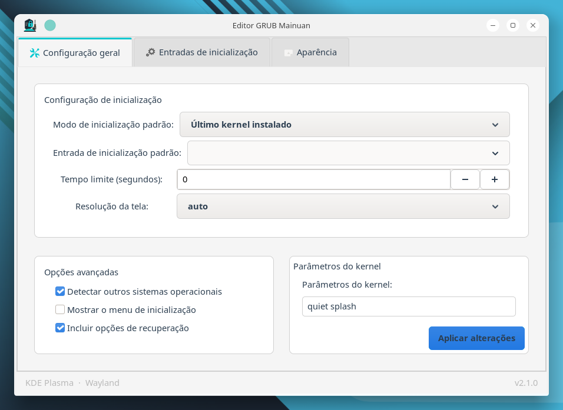

<div align="center">


# Mainuan GRUB Editor

Graphical editor for the GRUB configuration: boot settings, menu entries, themes, background, colours and fonts.

[](https://github.com/mainuan/mainuan-grub-editor/actions/workflows/ci.yml)
[](https://github.com/mainuan/mainuan-grub-editor/releases/latest)
[](LICENSE)


[Português](README.md) · **English**

</div>

---

<p align="center"></p>


## About

Mainuan GRUB Editor edits `/etc/default/grub` and the boot menu appearance
without a text editor, and offers to run `update-grub` to apply each change.
It is a Python/GTK 3 application that runs as root: the `mainuan-grub-editor`
launcher elevates through `pkexec` and passes the session language and theme
on. At start-up it runs a silent `update-grub` so the entry list matches the
installed kernels.

## Features

- **General**: default boot mode (fixed entry, last installed kernel or last booted entry), default entry including kernels in submenus, timeout, screen resolution, kernel parameters, OS detection, show menu, recovery entries.
- **Boot entries**: enable, disable and remove memtest and custom entries (with confirmation); add custom entries to `/etc/grub.d/40_custom`.
- **Appearance**: install themes from `.zip`, `.tar.gz`/`.tgz`, `.tar.xz` and `.tar.bz2` into `/boot/grub/themes/` with a preview; apply, disable and remove themes; PNG/JPEG background and normal/highlight colours; TTF/OTF fonts converted to PF2 with `grub-mkfont`.
- Light or dark interface following the session theme, on Wayland and X11.
- Interface translated into 33 languages, following the KDE Plasma language.

## Installation

The editor ships preinstalled in the Mainuan Linux ISO. On another
Kubuntu/Ubuntu 26.04 system, download the `.deb` and `SHA256SUMS` from the
[latest release](https://github.com/mainuan/mainuan-grub-editor/releases/latest):

```bash
sha256sum --check --ignore-missing SHA256SUMS
sudo apt install ./mainuan-grub-editor_2.1.0_all.deb
```

## Usage

```bash
mainuan-grub-editor
```

No command-line options (see `man mainuan-grub-editor`). Set
`MAINUAN_THEME_TYPE=dark|light` or `GTK_THEME=<theme>` to override the
detected interface theme.

## Building and testing

```bash
git clone https://github.com/mainuan/mainuan-grub-editor.git
cd mainuan-grub-editor
sudo apt build-dep ./
dpkg-buildpackage -us -uc -b      # runs python3 -m unittest discover -s tests -v
```

CI ([`ci.yml`](.github/workflows/ci.yml)) also runs `po/i18n.sh check-pot`,
`po/i18n.sh validate`, `bash -n` on the shell scripts and a syntax check of
every `.py` file, then lints the package, installs it in a clean Ubuntu 26.04
container, starts the installed application under Xvfb in Portuguese and
English, and removes it. Releases are published only from `v*` tags.

## Translations

33 languages via gettext; see [docs/i18n/README.md](docs/i18n/README.md).

## Contributing

Issues and pull requests are welcome at
[github.com/mainuan/mainuan-grub-editor](https://github.com/mainuan/mainuan-grub-editor);
CI must pass.

## Credits

David Caixinha ([@tugatechlabDC](https://github.com/tugatechlabDC)),
Daigo ([@daigoasuka](https://github.com/daigoasuka)) and
Rafael Ruscher ([@ruscher](https://github.com/ruscher)). Derived from
**Soplos GRUB Editor** by Sergi Perich.

## License

[GPL-3.0-or-later](LICENSE).
