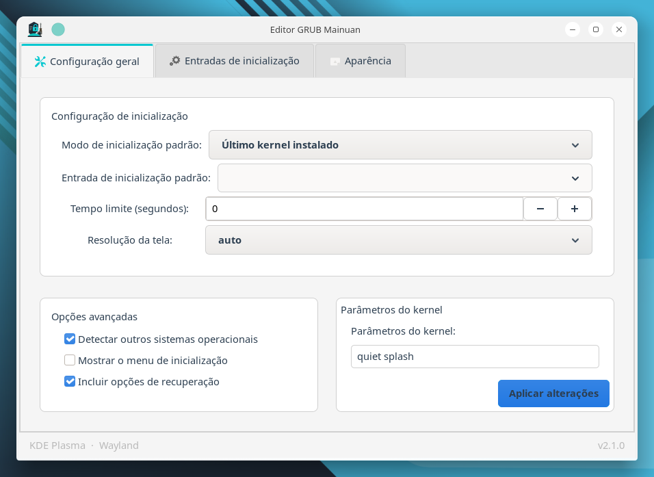

<div align="center">


# Mainuan GRUB Editor

Editor gráfico da configuração do GRUB: inicialização, entradas do menu, temas, fundo, cores e fontes.

[](https://github.com/mainuan/mainuan-grub-editor/actions/workflows/ci.yml)
[](https://github.com/mainuan/mainuan-grub-editor/releases/latest)
[](LICENSE)


**Português** · [English](README.en.md)

</div>

---

<p align="center"></p>


## O que é

O Mainuan GRUB Editor altera o `/etc/default/grub` e a aparência do menu de
boot sem que seja preciso abrir um editor de texto. Cada mudança é gravada no
arquivo e aplicada com `update-grub`, que o próprio programa oferece executar.

É um aplicativo Python com GTK 3. Ele roda como root: o lançador
`mainuan-grub-editor` pede a senha pelo `pkexec` e repassa ao processo elevado
o idioma e o tema da sessão. Ao abrir, executa um `update-grub` silencioso para
que a lista de entradas reflita os kernels instalados.

## Funcionalidades

- **Configuração geral**
  - modo de inicialização padrão: entrada fixa, último kernel instalado ou última entrada iniciada (`GRUB_DEFAULT`/`GRUB_SAVEDEFAULT`);
  - entrada padrão, inclusive kernels dentro de submenus;
  - tempo de espera, resolução da tela (`GRUB_GFXMODE`) e parâmetros do kernel (`GRUB_CMDLINE_LINUX_DEFAULT`);
  - detectar outros sistemas operacionais, mostrar o menu e incluir as opções de recuperação.
- **Entradas de inicialização**
  - lista as entradas geradas pelo GRUB;
  - ativa, desativa e remove entradas do memtest e entradas personalizadas, com confirmação antes de remover;
  - adiciona entradas personalizadas em `/etc/grub.d/40_custom`.
- **Aparência**
  - instala temas de arquivos `.zip`, `.tar.gz`/`.tgz`, `.tar.xz` e `.tar.bz2` em `/boot/grub/themes/`, com pré-visualização; aplica, desativa e remove temas;
  - imagem de fundo PNG ou JPEG e cores do texto normal e do item selecionado;
  - converte fontes TTF/OTF para o formato do GRUB (PF2) com `grub-mkfont`.
- Interface clara ou escura conforme o tema da sessão, em Wayland e X11.
- Interface traduzida em 33 idiomas, que segue o idioma escolhido no KDE Plasma.

## Instalação

O Mainuan GRUB Editor já vem instalado na ISO do Mainuan Linux.

Em outro sistema Kubuntu/Ubuntu 26.04, baixe o `.deb` e o `SHA256SUMS` da
[última release](https://github.com/mainuan/mainuan-grub-editor/releases/latest),
confira e instale:

```bash
sha256sum --check --ignore-missing SHA256SUMS
sudo apt install ./mainuan-grub-editor_2.0.2.deb
```

O `apt` instala as dependências (`python3-gi`, `gir1.2-gtk-3.0`,
`grub2-common`, `pkexec`, `unzip`).

## Uso

Abra **Mainuan GRUB Editor** no menu de aplicativos (categoria Sistema/Configurações) ou execute:

```bash
mainuan-grub-editor
```

O programa não tem opções de linha de comando; tudo é feito pela interface
(`man mainuan-grub-editor`). A senha de administrador é pedida pelo `pkexec`.

| Arquivo | Uso |
|---|---|
| `/etc/default/grub` | configuração principal alterada pelo programa |
| `/etc/grub.d/40_custom` | entradas personalizadas |
| `/boot/grub/themes/` | temas instalados |
| `/boot/grub/fonts/` | fontes convertidas |

Se a interface não acompanhar o tema da sessão, force-o por variável de ambiente:

```bash
MAINUAN_THEME_TYPE=dark mainuan-grub-editor   # dark ou light
GTK_THEME=Breeze-Dark mainuan-grub-editor
```

## Informações técnicas

| Item | Valor |
|---|---|
| Linguagem | Python 3 |
| Toolkit | GTK 3 (PyGObject) |
| Base | Kubuntu 26.04 LTS, KDE Plasma 6.6 |
| Pacote | `mainuan-grub-editor`, `Architecture: all` |
| Dependências | `python3-gi`, `gir1.2-gtk-3.0`, `grub2-common`, `pkexec`, `unzip` |
| Privilégios | root via `pkexec` |
| Arquitetura do sistema | amd64 |
| ID do aplicativo | `org.mainuan.grubeditor` (`.desktop` e metainfo AppStream) |

## Compilação e testes

O pacote é gerado a partir de `debian/` (debhelper 13) num Kubuntu/Ubuntu 26.04:

```bash
git clone https://github.com/mainuan/mainuan-grub-editor.git
cd mainuan-grub-editor
sudo apt build-dep ./
dpkg-buildpackage -us -uc -b      # gera ../mainuan-grub-editor_<versão>_all.deb
```

A versão vem de `debian/changelog`. O `debian/rules` executa os testes
(`python3 -m unittest discover -s tests -v`) durante o build. Antes dele, o CI
executa:

```bash
po/i18n.sh check-pot     # o POT está em dia com o código
po/i18n.sh validate      # catálogos válidos e marcadores preservados
bash -n packaging/mainuan-grub-editor packaging/build-data.sh po/i18n.sh
```

e confere a sintaxe de todos os arquivos `.py`.

O workflow [`CI`](.github/workflows/ci.yml) usa o pipeline Debian comum da
organização: build num contêiner Ubuntu 26.04 fixado por digest, `lintian`,
`SHA256SUMS`, instalação num Ubuntu 26.04 limpo, teste de fumaça (valida o
`.desktop` e o metainfo e abre o aplicativo instalado sob Xvfb, em português e
em inglês), reinstalação, remoção e expurgo. A release só é publicada por uma
tag `v*` e nunca substitui uma existente.

## Traduções

A interface, o `.desktop` e o metainfo AppStream usam gettext (domínio
`mainuan-grub-editor`, textos-fonte em inglês) e estão disponíveis em 33
idiomas: ar, bn, cs, da, de, el, es, fa, fi, fr, he, hi, hu, id, it, ja, ko,
nb, nl, pl, pt, pt_BR, ro, ru, sv, sw, th, tr, uk, ur, vi, zh_CN e zh_TW.

Os catálogos ficam em `locale/<idioma>/LC_MESSAGES/`. Como atualizar, validar
e acrescentar idiomas: [docs/i18n/README.md](docs/i18n/README.md).

## Contribuição

Relate problemas em [Issues](https://github.com/mainuan/mainuan-grub-editor/issues)
e envie mudanças por pull request para `main`. Todo PR passa pelo
[CI](https://github.com/mainuan/mainuan-grub-editor/actions/workflows/ci.yml),
que precisa estar verde. Registre mudanças visíveis no
[CHANGELOG.md](CHANGELOG.md) e em `debian/changelog`.

## Créditos

- David Caixinha ([@tugatechlabDC](https://github.com/tugatechlabDC)): desenvolvedor e mantenedor do pacote (`debian/control`).
- Daigo ([@daigoasuka](https://github.com/daigoasuka)): versão original publicada neste repositório.
- Rafael Ruscher ([@ruscher](https://github.com/ruscher)): internacionalização, empacotamento Debian, CI e correções.

Origem: derivado do **Soplos GRUB Editor**, de Sergi Perich, citado na página
de manual e nos cabeçalhos dos catálogos de tradução.

## Licença

[GPL-3.0-or-later](LICENSE).
